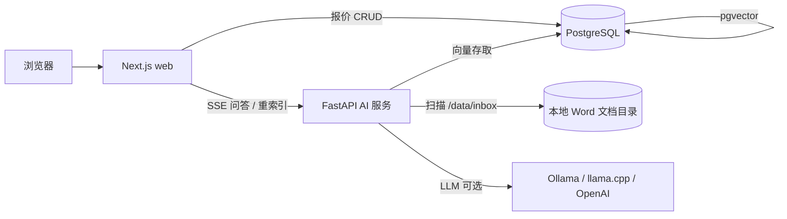

# 工业销售询盘知识库系统（rag-all-stack）

面向工业销售询盘的 RAG 知识库系统（精简版）：文档管理（本地文件夹扫描索引）、报价管理与智能问答。无文件上传、无消息队列、无独立向量库，整体保持轻量。

- **apps/web**：Next.js 16 前端 + 业务 API（问答 SSE 代理、图片询盘、报价 CRUD、重索引触发）
- **services/ai**：FastAPI AI 服务（python-docx 解析、fastembed 向量化、pgvector 检索与问答）
- **packages**：Drizzle schema / 共享类型
- **tooling**：共享 TS / ESLint / Prettier 配置

## 架构



## 快速开始

### 1. 配置环境变量

```bash
cp .env.example .env                                # 应用共用（Next.js / AI 服务本地运行 / 数据库脚本）
cp docker-compose/.env.example docker-compose/.env  # docker compose 专用（compose 自动加载同目录 .env，无需 --env-file）
```

### 2. 启动基础设施（仅 PostgreSQL）

```bash
docker compose -f docker-compose/docker-compose.yml up -d
```

> 默认只启动 PostgreSQL；AI 服务在宿主机直跑（热更新）。部署时才加 `--profile deploy` 一并启动 AI 容器。
> 两份 env 的端口/凭据需联动修改：`docker-compose/.env` 管宿主机端口映射与容器凭据，根 `.env` 管各应用的连接串。
> 若 PyPI 下载不稳定，可在 `docker-compose/.env` 中把 `PYPI_INDEX_URL` 切换为镜像源（如 `https://mirrors.aliyun.com/pypi/simple`），重建 AI 镜像时生效。

### 3. 启动 AI 服务（本地热更新）

```bash
cd services/ai
poetry run uvicorn app.main:app --reload --port 8008    # 监听 8008，改代码自动重启
```

> 首次运行会按 `HF_ENDPOINT`（默认 hf-mirror.com）下载嵌入模型；文档目录与 LLM 均读取根 `.env`（`DOCS_DIR` / `LLM_*`）。

### 4. 初始化数据库

```bash
pnpm install
pnpm --filter @rag/database db:init        # 建表 + pgvector 扩展
pnpm --filter @rag/database db:seed        # 写入示例报价
```

### 5. 放入文档并重建索引

把 Word 文档（.docx）放入 `data/inbox/` 目录，然后：

```bash
curl -X POST http://localhost:3000/api/sync    # 或访问 http://localhost:3000/admin/documents 点击「扫描文件夹并重建索引」
```

### 6. 启动开发环境

```bash
pnpm dev                                   # 启动 web(3000)
```

打开 http://localhost:3000 ，登录 `/login`（任意邮箱 + 至少 6 位密码，演示认证）。

## 常用命令

| 命令 | 说明 |
| --- | --- |
| `pnpm dev` | 启动 web（热更新） |
| `pnpm build` | 构建所有应用 |
| `pnpm lint` / `pnpm typecheck` / `pnpm test` | 全仓检查 |
| `pnpm --filter @rag/database db:generate` | 修改 schema 后生成迁移 |
| `pnpm --filter @rag/database db:migrate` | 应用 drizzle 迁移 |
| `curl -X POST http://localhost:3000/api/sync` | 手动触发全量重索引（文档 + 报价） |
| `cd services/ai && poetry run uvicorn app.main:app --reload --port 8008` | 本地启动 AI 服务（热更新，端口 8008） |

## AI 服务（services/ai）

```bash
cd services/ai
poetry run uvicorn app.main:app --reload --port 8008      # 本地热更新开发（端口 8008）
poetry run pytest                                     # 测试
poetry run ruff check . && poetry run mypy app tests   # lint + 类型检查
```

- 默认嵌入模型 `BAAI/bge-small-zh-v1.5`（512 维，fastembed/ONNX 本地推理，无 torch 依赖）；切换模型时同步修改 `EMBED_MODEL`/`EMBED_DIM`（本地直跑改根 `.env`，部署容器改 `docker-compose/.env`）
- 未配置 `LLM_BASE_URL` 时问答降级为直接返回检索资料；配置 OpenAI 兼容接口（如 GLM Coding Plan）后启用生成式回答
- 图片询盘：`POST /api/ask/image`（multipart：`question` + `image`）用 RapidOCR（onnxruntime 引擎，模型打包在 wheel 内无需下载）识别规格参数截图 → 向量检索 → 流式生成产品型号与价格推荐；聊天页输入框旁的上传按钮即走此链路
- 接口：`POST /api/reindex`（全量重索引）、`POST /api/reindex-quotes`（仅报价）、`GET /api/documents`（已索引文档）、`POST /api/ask/stream`（SSE 问答）、`POST /api/ask/image`（图片询盘）

## 环境变量

| 变量 | 说明 |
| --- | --- |
| `DATABASE_URL` | PostgreSQL 连接串 |
| `AI_SERVICE_URL` | AI 服务地址（本地直跑 `http://localhost:8008`；部署容器 `http://localhost:58008`） |
| `DOCS_DIR` | AI 服务本地直跑时的文档目录（容器部署固定 `/data/inbox`） |
| `NEXTAUTH_SECRET` / `NEXTAUTH_URL` | NextAuth 配置 |
| `EMBED_MODEL` / `EMBED_DIM` | AI 服务嵌入模型（fastembed） |
| `HF_ENDPOINT` | 模型下载源（默认 `https://hf-mirror.com`，可改回 `https://huggingface.co`） |
| `LLM_BASE_URL` / `LLM_MODEL` / `LLM_API_KEY` | LLM（OpenAI 兼容接口；GLM Coding Plan 用 `https://api.z.ai/api/coding/paas/v4`） |
| `LLM_REASONING_EFFORT` | 推理强度 low/high/max（glm-5.3 等推理模型，留空不发送） |

环境文件只有两份：根目录 `.env`（模板 `.env.example`）给 Next.js / 本地 AI 服务 / 数据库脚本共用；`docker-compose/.env`（模板 `docker-compose/.env.example`）仅放 compose 专用变量（镜像、宿主机端口、凭据、容器内 AI 配置）。二者中的端口与凭据需保持一致。

## 目录结构

```
apps/        web（Next.js）
packages/    database（Drizzle schema + migrations + seeds）、shared-types
tooling/     typescript-config、eslint-config、prettier-config
services/    ai（FastAPI，Poetry 管理，不属于 pnpm 工作区）
data/inbox/  待索引 Word 文档目录（只读挂载进 AI 容器 /data/inbox）
docker-compose/  基础设施编排（PostgreSQL + 部署用 AI 容器，`--profile deploy`）
docs/        产品规格说明书与项目文档
```
